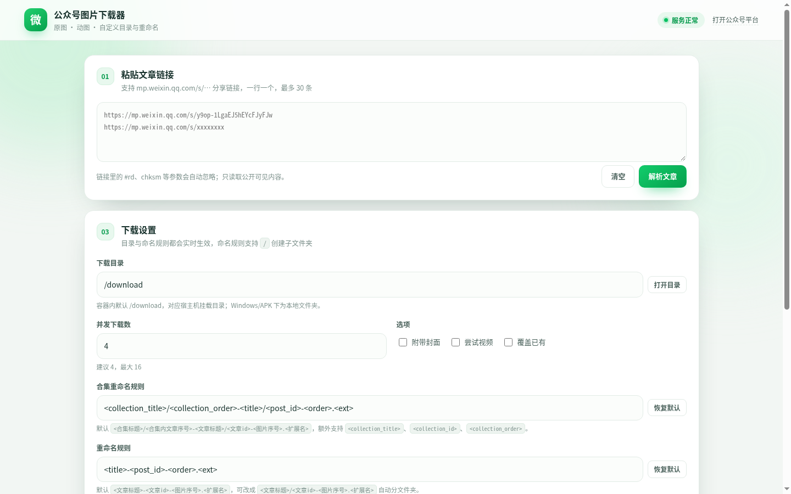
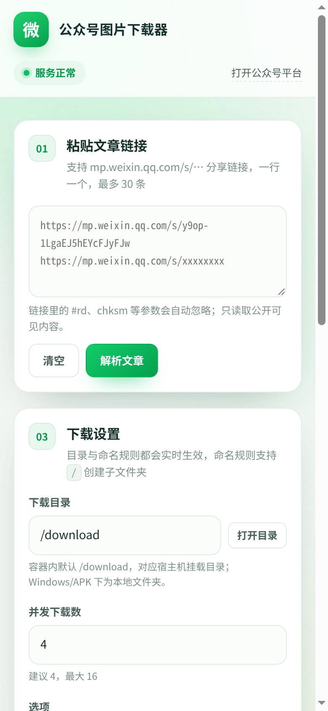

# 微信公众号图片下载器（wxmp）

一个专门下载 **微信公众号文章里的所有图片与动图原图** 的工具，提供六种用法：

| 形态 | 说明 |
| --- | --- |
| **Docker Compose + WebUI** | 一条命令起容器，浏览器操作，端口 `2178` |
| **Windows `.exe`** | 双击打开 WebUI，或命令行批量下载 |
| **Android `.apk`** | 手机粘贴链接直接下载，可自选保存目录 |
| **Go 单文件 CLI** | Linux/macOS/Windows 通用，适合脚本、NAS、服务器 |
| **油猴脚本（独立版）** | 在文章页/合集页直接下载，完全在浏览器本地运行，不依赖电脑端程序 |
| **油猴脚本（推送版）** | 文章页/合集页勾选后推送到本机 Docker 或 exe 的 WebUI 下载 |

核心能力：解析 `#js_content` 正文图片、图片消息的 `picture_page_info_list`、GIF 动图、封面；把 WeChat CDN 的缩略图 URL 自动换成 **`/0` 原图**；支持自定义下载目录与自定义重命名规则（含中文变量、`/` 建子目录）；支持 **公众号文章合集批量下载**（WebUI / CLI / APK / 两个油猴脚本）。




---

## 1. 快速开始

### 1.1 Docker Compose（推荐）

宿主机要求：Docker 20.10+、Docker Compose v2。

```bash
cd wechat-mp-downloader
cp .env.example .env        # 可选：修改下载目录与端口
docker compose up -d --build
```

打开 <http://127.0.0.1:2178>。

默认配置：

- 端口：`2178`（容器内 `0.0.0.0:2178`，宿主 `${WEB_PORT:-2178}`）
- 网络：`network_mode: bridge`
- 下载目录：宿主 `/mnt/media/wechat` → 容器 `/download`
- 重启策略：`unless-stopped`
- 健康检查：`wget -qO- http://127.0.0.1:2178/api/health`

镜像默认直接复制预编译的静态二进制（`build/wxmp-linux-amd64`），**构建通常只要几秒**，不会在容器里下载 Go 依赖。源码构建走 `Dockerfile.source`。

```bash
# 只重建镜像、不启动
docker compose build

# 看日志
docker compose logs -f wxmp

# 停止
docker compose down
```

> 如果下载目录不在 `/home/user/...`，改 `.env` 里的 `DOWNLOAD_DIR` 即可；路径含中文/空格没问题，Compose 会原样挂载。

### 1.2 Windows `.exe`

1. 解压/复制 `dist/wxmp-windows-amd64.exe`（可改名 `wxmp.exe`）。
2. 双击 → 自动启动本地 WebUI 并打开浏览器（默认 `http://127.0.0.1:2178`，下载目录为 exe 同级的 `downloads`）。
3. 或命令行：

```bat
wxmp.exe -o "D:\公众号图片" "https://mp.weixin.qq.com/s/xxxx"
wxmp.exe -o "D:\公众号图片" -name "<文章标题>/<文章id>-<图片序号>.<扩展名>" -j 8 链接1 链接2
wxmp.exe -dry-run 链接        :: 只预览，不下载
```

### 1.3 Android `.apk`

```bash
adb install -r dist/wxmp-android.apk
```

或把 APK 传到手机点击安装（允许“安装未知来源应用”）。

使用：粘贴文章链接 → **选择目录**（可选，默认 App 专属目录，无需存储权限）→ 需要时改命名规则 → **解析文章** → **开始下载**。

- 目录选择走 SAF（`ACTION_OPEN_DOCUMENT_TREE`），授权持久化，重启后仍有效。
- 支持“附带封面”“覆盖已有”“取消”。
- 默认保存到 `/sdcard/Android/data/com.wxmp.downloader/files/wxmp`。




### 1.4 命令行（Linux / macOS / Windows）

```bash
# 下载到当前目录下的 downloads
./wxmp "https://mp.weixin.qq.com/s/y9op-1LgaEJ5hEYcFJyFJw"

# 自定义目录 + 默认命名
./wxmp -o /data/pics "https://mp.weixin.qq.com/s/xxxx"

# 中文子目录命名
./wxmp -o /data/pics -name "<文章标题>/<文章id>-<图片序号>.<扩展名>" 链接

# 预览（不落盘）
./wxmp -dry-run -v 链接

# 交互式启动 WebUI
./wxmp -web -listen 0.0.0.0:2178 -o /download
```

不带任何参数运行 = 启动 WebUI（与双击 exe 行为一致）。

### 1.5 油猴脚本（Tampermonkey）

1. 安装 [Tampermonkey](https://www.tampermonkey.net/)。
2. 新建脚本，粘贴 `userscript/wxmp.user.js` 全部内容，保存。
3. 打开任意公众号文章（`https://mp.weixin.qq.com/s/...`），右下角出现 **“下载本文图片 N”** 悬浮按钮。
4. 可改命名规则、勾选“打包为 ZIP”“附带封面”，点开始下载。

脚本完全独立运行：只读取当前页面 DOM，图片走 `GM_xmlhttpRequest` 带 Referer 下载，保存用浏览器原生下载或 File System Access（可选择文件夹），不连接任何本地服务；配置存在 `GM_setValue("wxmp.cfg.v1")`。

**合集页多选**：脚本也匹配 `https://mp.weixin.qq.com/mp/appmsgalbum*`，合集页右下角有 **“合集批量下载”** 悬浮按钮，点开的小窗口里可以：
- **选择保存位置**（File System Access，直接写入所选文件夹，保留子目录）；
- **填写重命名规则**（与单篇同一套变量，`/` 建子文件夹）；
- 点 **“进入多选模式”**（默认关闭），勾选多篇后 **“批量下载所选文章”**。

不装浏览器也能跑核心自测：

```bash
node --check userscript/wxmp.user.js
node userscript/test.js        # 使用 testdata/article-fixture.html 断言解析、/0 原图、去重、命名
```

### 1.6 油猴脚本（推送终端版）

`userscript/wxmp-push.user.js` 与独立版**分开保存**，适合 NAS / 常开 Docker 下载：

1. 先在 Docker 或 exe 上启动 WebUI（默认 `http://127.0.0.1:2178`）。
2. 安装脚本，打开公众号文章页，右下角 **“推送到终端”**。
3. 面板里填 **服务地址（终端 IP:端口）**、**服务端下载目录**、**重命名规则** → 保存 → **推送当前文章**。脚本把 `out_dir`、`name_template` 一起发给 `/api/download`，服务端按你填的目录/规则落盘。
4. 合集页右下角有 **“推送到终端”** 悬浮按钮（位置比独立版高，两个脚本同装也不重叠），点开的小窗口里有同样的地址/目录/规则设置，再进入多选模式 → 勾选文章 → **批量推送所选**。

> **路径注意**：推送版填的是**服务端视角**的路径。Docker 里宿主目录 `/mnt/media/wechat` 挂载为容器内的 **`/download`**，所以这里要填 `/download`（或它下面的子目录），不能填宿主绝对路径；Windows exe 则直接填本机路径，如 `D:\公众号图片`。只填服务地址、不填目录时，服务端会用它的默认下载目录。

两个脚本互不依赖，可同时安装；推送版只发链接，独立版在浏览器本地保存。

---

## 2. 命名规则（重点）

默认规则：

```text
<文章标题>-<文章id>-<图片序号>.<扩展名>
```

等价英文写法：

```text
<title>-<post_id>-<order>.<ext>
```

渲染示例：`哪里搞错了-y9op-1LgaEJ5hEYcFJyFJw-1.png`。

### 2.1 变量表

| 变量 | 中文别名 | 含义 | 示例 |
| --- | --- | --- | --- |
| `<title>` | `<文章标题>` | 文章标题 | 哪里搞错了 |
| `<post_id>` | `<文章id>` | 文章短链 id（`/s/` 后面那串） | y9op-1LgaEJ5hEYcFJyFJw |
| `<order>` | `<图片序号>` | 图片序号，从 1 开始 | 3 |
| `<order2>` | `<序号2>` | 两位补零序号 | 03 |
| `<ext>` | `<扩展名>` | 扩展名，不含点 | png |
| `<account>` | `<公众号>` | 公众号名称 | 星空3532 |
| `<author>` | `<作者>` | 作者 | 星空 |
| `<date>` | `<日期>` | 发布日期 | 2026-10-21 |
| `<time>` | `<时间>` | 发布时间 `HHMMSS` | 173000 |
| `<year>` | `<年>` | 发布年份 | 2026 |
| `<month>` | `<月>` | 发布月份 | 10 |
| `<day>` | `<日>` | 发布日 | 21 |
| `<kind>` | `<类型>` | `image` / `gif` / `video` | image |
| `<width>` | `<宽>` | 原图宽度 | 1254 |
| `<height>` | `<高>` | 原图高度 | 1254 |
| `<biz>` | — | 公众号 biz | Mzg3MTgyMTA4Nw== |
| `<sn>` | — | 文章 sn | 3c28e0d4... |
| `<mid>` | — | 文章 mid | 2247523869 |
| `<idx>` | — | 文章 idx | 1 |
| `<file_id>` | — | 微信图片 fileid | 100040218 |
| `<source>` | — | `content` / `picture` / `cover` | content |

不写 `<ext>` 时程序会自动补真实扩展名。

### 2.2 用 `/` 创建子文件夹

```text
<文章标题>/<文章id>-<图片序号>.<扩展名>
```

实际保存为：

```text
/download/哪里搞错了/y9op-1LgaEJ5hEYcFJyFJw-1.png
/download/哪里搞错了/y9op-1LgaEJ5hEYcFJyFJw-2.jpg
```

也可以多层：

```text
<公众号>/<日期>/<文章标题>/<order2>.<ext>
→ /download/星空3532/2026-10-21/哪里搞错了/01.png
```

规则说明：

- `/` 和 `\` 都视为目录分隔符；每一段单独做非法字符清洗。
- 文件名禁止的字符 `< > : " | ? *`、控制字符会被替换为 `_`；Windows 保留名（CON、NUL 等）自动加 `_`。
- 模板渲染后的相对路径不允许越出下载根目录（`..` 会被清洗并通过 `filepath.Rel` 双重校验）。
- 同名文件默认跳过；`-force` / “覆盖已有”才覆盖；同一批内重名会自动加 `-2`、`-3`。

### 2.3 合集命名规则（单独设置）

下载公众号文章合集时使用独立模板，默认：

```text
<collection_title>/<collection_order>-<title>/<post_id>-<order>.<ext>
```

中文写法：

```text
<合集标题>/<合集内文章序号>-<文章标题>/<文章id>-<图片序号>.<扩展名>
```

除单篇全部变量外，新增：

| 变量 | 中文别名 | 含义 | 示例 |
| --- | --- | --- | --- |
| `<collection_title>` | `<合集标题>` | 合集标题 | 猫咪 |
| `<collection_id>` | `<合集ID>` | 合集 id（链接里的 `album_id`） | 3186378941922820100 |
| `<collection_order>` | `<合集内文章序号>` | 文章在合集内的序号（1 = 最早，越大越新） | 106 |

示例输出：

```text
/download/猫咪/106-公司的后辈也是猫妖吗/2247492190-1.png
/download/猫咪/106-公司的后辈也是猫妖吗/2247492190-5.gif
```

`/` 同样建子目录；合集模板在 WebUI、CLI（`-collection-name`）、APK 里都可单独修改。油猴脚本多选下载沿用**单篇**规则，不额外使用合集模板。

---

## 3. 功能细节

- **只取原图**：正文 `data-src` 常以 `/640?wx_fmt=jpeg` 结尾，程序把最后一段尺寸替换成 `/0`，拿到公众号图床保存的原始尺寸（实测 1080×1080 → 1254×1254，1080×1525 → 2508×3541）。
- **GIF 动图**：识别 `data-type="gif"`、`wx_fmt=gif`、`.gif`，按 `gif` 类型保存，保留动画帧；GIF 的 `/0` 同样是原图。
- **图片消息**：除普通图文外，支持 `picture_page_info_list` 形式的图片消息；只取每个条目自己的顶层 `cdn_url`，不会误取 `watermark_info` 水印图。
- **顺序与去重**：以正文 `#js_content` 出现顺序为准，按 CDN host+path 去重；`picture_page_info_list` 中重复的图不会重复下载。
- **封面可选**：默认不下载封面；CLI `-cover`、WebUI 勾选“附带封面”、油猴勾选“附带封面”。
- **内嵌视频（实验性）**：`-video` / “尝试视频”会在页面里探测直接视频地址与 `mpvideo` 计数；微信视频多需专用接口，失败会给出提示而不影响图片。
- **健壮下载**：并发 1–16（默认 4）、每张 3 次重试、`.part` 临时文件原子改名、真实文件头校验、按真实尺寸/格式修正扩展名、MD5 记录、失败不影响其它图片。
- **跳过已存在**：按目标文件名判断，已存在且非空即跳过；`-force` 覆盖。
- **合集批量**：识别 `mp/appmsgalbum` 链接，解析 `window.cgiData` 首屏 + JSON 分页接口，最多 300 篇；WebUI/APK 可先解析出文章列表，CLI 用 `-max-articles` 限制；每篇文章单独解析、下载，合集元数据回填后按合集模板命名。
- **环境异常**：触发微信“环境异常”验证页时，会提示先在浏览器打开一次文章（或提供 Cookie），不会把验证页当图片保存。

---

## 4. WebUI

启动后：

1. **01 粘贴文章链接**：每行一个，最多 30 条；支持带 `#rd`、`chksm` 等参数的分享链接。
2. **02 内容预览**：显示标题、公众号、发布时间、图片数量、缩略图、尺寸、GIF 标记、首个文件名。
3. **03 下载设置**：下载目录（含“打开目录”）、并发数、“附带封面 / 尝试视频 / 覆盖已有”、命名规则输入 + 变量快捷插入 + 实时预览 + 恢复默认。
4. **04 下载进度**：进度条、成功/跳过/失败统计、实时日志、文件列表、取消按钮。

设置自动保存在浏览器 `localStorage`（键 `wxmp.settings.v1`）。也支持 `?url=<文章链接>` 直接解析，方便做书签。

### HTTP API（自测/集成用）

| 方法 | 路径 | 说明 |
| --- | --- | --- |
| GET | `/api/config` | 默认目录、命名规则、变量表、并发上限 |
| GET | `/api/health` | 健康检查 |
| POST | `/api/parse` | `{"urls":[...],"name_template":"..."}` 解析文章 |
| POST | `/api/preview` | 按模板渲染文件名（不下载） |
| POST | `/api/download` | 创建下载任务 |
| GET | `/api/jobs/{id}` | 任务进度与结果 |
| POST | `/api/jobs/{id}/cancel` | 取消任务 |
| GET | `/api/thumb?u=...&s=300` | 缩略图代理（仅微信图床域名） |
| POST | `/api/open-dir` | 打开下载目录（本机运行时） |

---

## 5. 构建

### 5.1 Go 二进制

```bash
go build -trimpath -o wxmp ./cmd/wxmp

# Linux 静态（容器用）
CGO_ENABLED=0 GOOS=linux GOARCH=amd64 go build -trimpath -ldflags "-s -w" -o build/wxmp-linux-amd64 ./cmd/wxmp

# Windows
CGO_ENABLED=0 GOOS=windows GOARCH=amd64 go build -trimpath -ldflags "-s -w" -o dist/wxmp-windows-amd64.exe ./cmd/wxmp
```

`scripts/build.sh` 会一次性完成 gofmt 检查、`go vet`、单测、Linux/Windows 交叉编译并注入版本号。

### 5.2 Docker 镜像

```bash
# 快速构建（复制 build/wxmp-linux-amd64）
docker compose build

# 完全源码构建（容器内编译）
docker build -f Dockerfile.source -t wechat-mp-downloader:source .
```

### 5.3 Android APK

无需 Gradle，使用 Android SDK 命令行工具：

```bash
export ANDROID_SDK_ROOT=/opt/android-sdk
export JAVA_HOME=/opt/jdk21
bash android/build-apk.sh
# 产物：dist/wxmp-android.apk
```

脚本流程：`aapt2 compile → aapt2 link → javac --release 8 → d8 → zip 注入 classes.dex → zipalign → apksigner`。首次会自动生成 `android/wxmp-release.keystore`（alias `wxmp`，口令 `wxmp123456`，仅用于本地测试签名）。

> 注意：本仓库的 Android 代码不使用匿名内部类与 lambda，全部用具名 static 嵌套类 + `Handler`；这是为了绕开 build-tools 34.0.0 的 d8 在解析 javac 21 匿名类时的 NPE。

---

## 6. 目录结构

```text
wechat-mp-downloader/
├── cmd/wxmp/              # CLI 入口、批量处理、Windows 控制台
├── internal/wx/           # 抓取、解析、命名、下载（纯标准库）
├── internal/webui/        # WebUI 服务、任务管理、静态页面
├── android/               # 原生 Android 工程（无 Gradle）
├── userscript/            # wxmp.user.js（独立版）+ wxmp-push.user.js（推送版）+ test.js
├── docker-compose.yml
├── Dockerfile             # 预编译二进制快速镜像
├── Dockerfile.source      # 源码构建镜像
├── scripts/build.sh
├── deploy.sh
├── dist/                  # exe / apk / zip
├── docs/                  # 截图
├── testdata/
├── STRATEGY.md
├── AGENTS.md
└── TEST_REPORT.md
```

---

## 7. 常见问题

**Q：提示“环境异常/访问过于频繁”？**
微信对匿名请求有风控。先用浏览器打开该文章一次，再把浏览器 Cookie 传给 CLI：`wxmp -cookie "..." 链接`，或设置环境变量 `WXMP_COOKIE`。WebUI 的 Cookie 支持在服务端配置（不落盘）。

**Q：合集链接怎么用？**
直接粘贴 `https://mp.weixin.qq.com/mp/appmsgalbum?...&album_id=...`。WebUI/APK 会显示合集文章列表；CLI 加 `-max-articles 2` 只下前 2 篇。合集命名规则在 WebUI「合集重命名规则」、CLI `-collection-name`、APK 合集规则输入框里单独设置。

**Q：两个油猴脚本装哪个？**
想完全在浏览器本地保存（可打包 ZIP、可选文件夹）装 `wxmp.user.js`；想把手上的链接交给常开的 Docker/exe 去下载装 `wxmp-push.user.js`。二者互不依赖，可同时装。

**Q：下载下来的是缩略图？**
本工具默认把 `/640` 等尺寸段替换为 `/0`。如果某张图在 CDN 上没有原图，`/0` 会返回与页面相同尺寸，这是微信侧的限制。

**Q：动图变成静态图？**
确认保存的扩展名是 `.gif`（预览里有 GIF 徽标）。若文章把动图以视频形式插入，请用 `-video` 尝试视频下载。

**Q：端口 2178 被占用？**
改 `.env` 的 `WEB_PORT`，例如 `WEB_PORT=2180`，然后 `docker compose up -d`。

**Q：容器里“打开目录”没反应？**
容器内无法打开宿主文件管理器，属正常现象；直接去宿主挂载目录查看。本机运行 exe/二进制时该按钮可用。

**Q：Android 下载到哪？**
默认 App 专属目录，不需要存储权限；可点“选择目录”授权任意文件夹（SAF）。

---

## 8. 验证记录（摘要）

完整记录见 [TEST_REPORT.md](TEST_REPORT.md)。

- 测试文章：`https://mp.weixin.qq.com/s/y9op-1LgaEJ5hEYcFJyFJw`（《哪里搞错了》，公众号“星空3532”，8 张图，2026-10-21 发布）。
- CLI：8/8 成功，共 3.1 MB；第 1 张 1254×1254、第 4 张 2508×3541，证明取到 `/0` 原图。
- 中文子目录模板：生成 `哪里搞错了/y9op-1LgaEJ5hEYcFJyFJw-1.png` … `-8.jpg`；重复运行 8 个全部跳过。
- WebUI：`/api/parse` 2.83s 返回 8 项；`/api/download` 任务 `done`，8 成功 0 失败；缩略图代理返回 PNG。
- Windows exe（Wine 实测）：8/8 成功，中文子目录正确。
- Android APK：`apksigner verify` 通过；在 x86_64 模拟器里实际输入测试链接，解析出 8 项并下载，日志显示「8 成功 · 0 跳过 · 0 失败」；同源代码的桌面 JVM 自测 8/8、3,268,131 字节。
- 油猴脚本：`node --check` 通过；`node userscript/test.js` 断言解析、GIF 识别、去重、`/0` 原图与中文命名全部通过。
- Docker：`docker-compose config` 校验出 `network_mode: bridge`、`2178:2178`、宿主目录挂载；同一镜像运行层（Alpine 3.20 + musl 静态二进制 + entrypoint）在 chroot 内完成 8/8 下载与 WebUI 健康检查。实际 `docker build/up` 需在具备容器权限的宿主机执行。

### 1.1.0 修复（短链 id 与重复计数）

- `<post_id>` / `<文章id>` 改为取文章链接 `/s/` 后的短 id（如 `tC1hauHuVvqRusojhhXe5g`）；缺失时才回退 `appmsgid`/`mid`。数字 id 仍可用 `<mid>`。
- 修复“3 张图显示成 6 张”：同一张图在正文里可能是 `mmbiz_jpg/<hash>`、在图集里是 `sz_mmbiz_jpg/<hash>`，旧去重键包含目录前缀导致重复；现按图片 hash（最后一段非尺寸段）去重。
- 用 `https://mp.weixin.qq.com/s/tC1hauHuVvqRusojhhXe5g` 实测：CLI、WebUI、Android core（桌面 JVM）与油猴解析均为 **3 张**（849×1200、849×1200、934×899），下载 3/3 成功；旧文章仍为 8 张。

### 1.1.4 加固（仍报 6 张时）

- 去重身份使用 **完整文件名**；1.1.4 曾短暂改成 hash 前 16 位，1.2.1 已修正——微信 CDN 的不同图片也可能共享前 33 个字符，截前缀会把 4 张图误合并成 1 张。
- 图集与正文“数量相同、尺寸逐项相同”时，整组视为镜像并忽略，即使两边的 hash 完全不同也能折叠。
- 下载器额外按 **文件 MD5** 去重：不同 URL 返回相同字节时，只保留第一份，其余标记为“跳过重复文件”。
- WebUI 文章卡新增 `正文 X · 图集 Y` 和黄色警告条，能直接看出 6 张来自正文、图集还是重复链接。

### 1.2.1 刷新续显与四图误合并修复

- **WebUI 刷新续显**：当前任务 ID 存入 `localStorage`，刷新页面后自动恢复进度卡、实时日志、文件列表与轮询；服务重启/任务清理后自动丢弃过期指针。
- **修复图片缺漏**：`cdnKey` 改为完整文件名去重，不再截取 16 位前缀；实测 `mid=2247488472` 文章正文 3 张 PNG + 1 张 GIF 全部保留（此前只剩 1 张）。
- Go / Android / 独立版油猴 / 推送版同步该去重规则；新增“共享 33 字符前缀的不同图片”回归测试。

### 1.2.0 合集批量与双版本油猴

- 新增公众号合集识别与批量下载：CLI `-max-articles` / `-collection-name`，WebUI 合集卡片，APK 合集输入，两个油猴脚本的合集多选。
- 实测合集 `https://mp.weixin.qq.com/mp/appmsgalbum?__biz=MzkzOTYwMzE0NQ==&action=getalbum&album_id=3186378941922820100`：解析 106 篇；CLI 下载前 2 篇 10 张（5 张/篇，含 1 个 GIF），10/10 成功；WebUI 任务 `done total=5 success=5`；Android APK 在模拟器里解析出 106 篇并开始批量下载，取消前已成功 26 张，路径形如 `猫咪/106-公司的后辈也是猫妖吗/2247492190-1.png`。
- 独立版油猴合集多选在浏览器 harness 实测：勾选 2 篇 → `完成：2/2 篇，2 张成功`，文件名 `测试文章标题-fixture1-1.png`、`测试文章标题-fixture2-1.png`，全程不连接本地服务。
- 推送版油猴在 mock 服务下实测：文章页推送提交 `{urls:[当前文章]}`；合集页勾选 2 篇提交两个链接，轮询任务状态到 `done`。

## 9. 声明

仅用于下载**公开可访问**的公众号文章图片，请遵守微信平台规则与著作权法，不要用于批量抓取、二次分发或商业用途。Cookie 只在内存中使用，不会写入磁盘或日志。

## 任务记录持久化（1.2.2+）

- 任务历史写在 `data/jobs.json`；Docker 已把 `./data` 挂到 `/data`，并用 `-data /data` 启动。
- 重启后已完成/失败/取消任务全部保留；重启时仍在运行的任务标为失败（“服务重启导致任务中断”）。
- WebUI 增加“历史任务”面板，可回看、点开旧任务结果。
