# 微信公众号图片下载器（wxmp）

> **截图说明**：本仓库 README 中的界面图均为 **容器实际运行的测试数据截图**，示例内容（任务名、文件名、链接、账号等）全部为本地生成的测试数据，不含任何真实链接、账号信息或视频画面。

一个专门下载 **微信公众号文章里的所有图片与动图原图** 的工具，提供六种用法：

| 形态 | 说明 |
| --- | --- |
| **Docker Compose + WebUI** | 一条命令起容器，浏览器操作，端口 `2178` |
| **Windows `.exe`** | 双击打开 WebUI，或命令行批量下载 |
| **Android `.apk`** | 手机粘贴链接直接下载，可自选保存目录 |
| **Go 单文件 CLI** | Linux/macOS/Windows 通用，适合脚本、NAS、服务器 |
| **油猴脚本（独立版）** | 在文章页/合集页直接下载，完全在浏览器本地运行，不依赖电脑端程序 |
| **油猴脚本（推送版）** | 文章页/合集页勾选后推送到本机 Docker 或 exe 的 WebUI 下载 |

核心能力：解析 `#js_content` 正文图片、图片消息的 `picture_page_info_list`、GIF 动图、封面；把 WeChat CDN 的缩略图 URL 自动换成 **`/0` 原图**；支持自定义下载目录与自定义重命名规则（含中文变量、`/` 建子目录）；支持 **公众号文章合集批量下载**（WebUI / CLI / APK / 两个油猴脚本）；WebUI 支持 **定时追更**（盯合集或公众号，发现新文章自动下载，每个追更任务可单独设置下载目录与重命名规则，改规则会连带重命名已下载文件）和 **下载任务队列**（暂停/继续/取消/重试/批量操作）。

> 下面 README 引用的界面图全部为 **容器实际运行的测试数据截图**，示例账号、链接与内容均为本地生成的测试数据。

本项目使用 [MIT 许可证](LICENSE) 开源，可自由使用、修改与分发（请保留版权声明）。

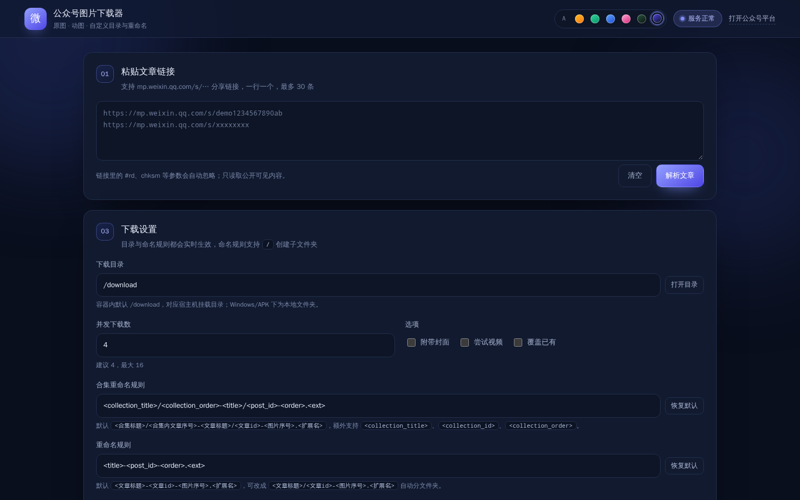

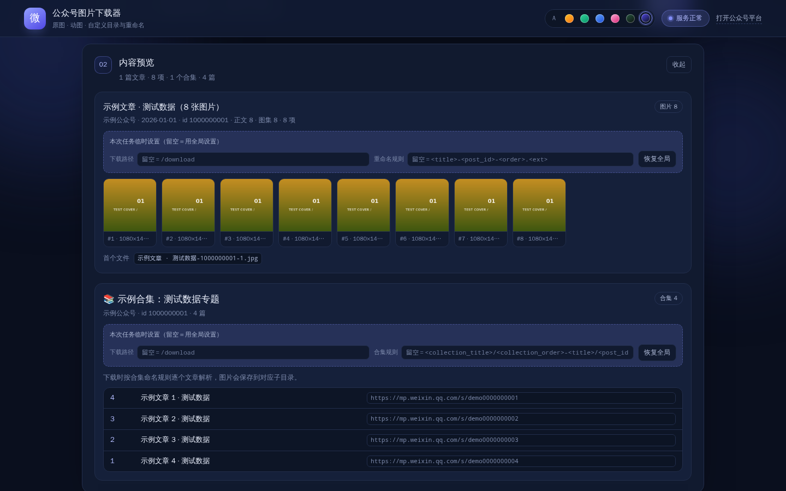

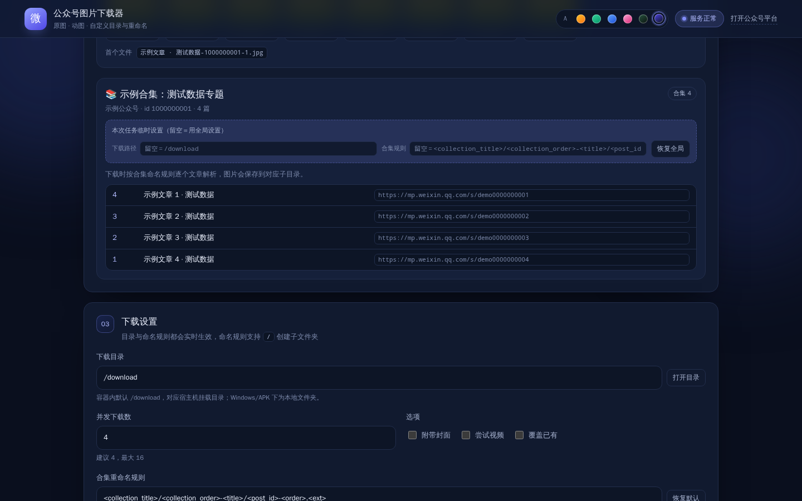

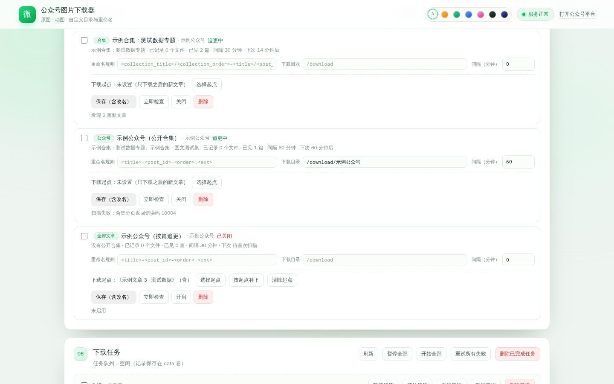

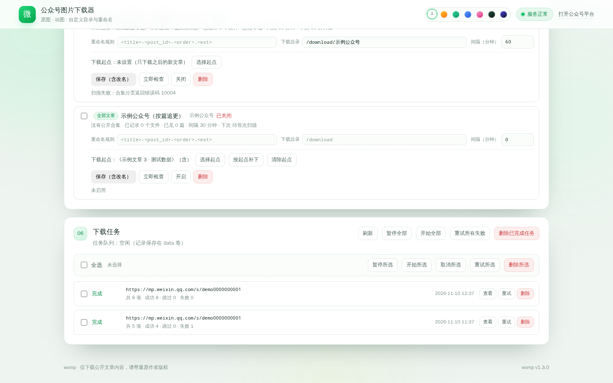

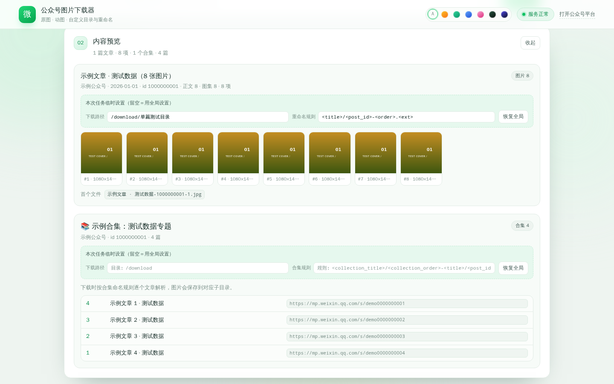

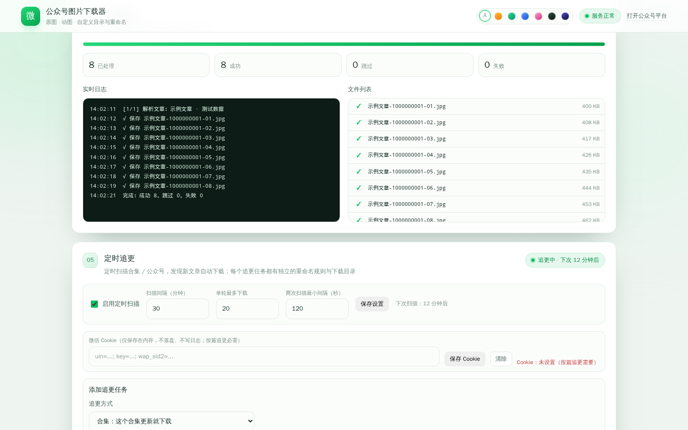

---

## 1. 快速开始

### 1.1 Docker Compose（推荐）

宿主机要求：Docker 20.10+、Docker Compose v2。

```bash
cd wechat-mp-downloader
cp .env.example .env        # 可选：修改下载目录与端口
docker compose up -d --build
```

打开 <http://127.0.0.1:2178>。

默认配置：

- 端口：`2178`（容器内 `0.0.0.0:2178`，宿主 `${WEB_PORT:-2178}`）
- 网络：`network_mode: bridge`
- 下载目录：宿主 `./downloads` → 容器 `/download`（`.env` 里的 `DOWNLOAD_DIR`，可改成任意绝对路径）
- 额外下载目录：宿主 `.env` 的 `FANBOOK_DIR` → 容器 `/fanbook`（可选；下载目录填 `/fanbook` 或它的子目录即可落到这个挂载点）
- 数据目录：宿主 `./data` → 容器 `/data`（任务历史 / 追更任务）
- 重启策略：`unless-stopped`
- 健康检查：`wget -qO- http://127.0.0.1:2178/api/health`

镜像默认直接复制预编译的静态二进制（`build/wxmp-linux-amd64`），**构建通常只要几秒**，不会在容器里下载 Go 依赖。源码构建走 `Dockerfile.source`。

```bash
# 只重建镜像、不启动
docker compose build

# 看日志
docker compose logs -f wxmp

# 停止
docker compose down
```

> 想换下载目录就改 `.env` 里的 `DOWNLOAD_DIR`（相对/绝对路径都行）；路径含中文/空格没问题，Compose 会原样挂载。WebUI 的目录输入框会把容器内可写目录作为候选项提示（`/api/config` 的 `download_roots`）。
>
> 需要第二个下载位置时（例如漫画 / 同人本目录），在 `.env` 里设置 `FANBOOK_DIR`，它会被挂载到容器内的 `/fanbook`；在 WebUI「下载目录」或推送版面板里填 `/fanbook`（或子目录）即可。容器内的 `/fanbook` 与 `/download` 是两个独立挂载点，互不影响。

### 1.2 Windows `.exe`

1. 解压/复制 `dist/wxmp-windows-amd64.exe`（可改名 `wxmp.exe`）。
2. 双击 → 自动启动本地 WebUI 并打开浏览器（默认 `http://127.0.0.1:2178`，下载目录为 exe 同级的 `downloads`）。
3. 或命令行：

```bat
wxmp.exe -o "D:\公众号图片" "https://mp.weixin.qq.com/s/xxxx"
wxmp.exe -o "D:\公众号图片" -name "<文章标题>/<文章id>-<图片序号>.<扩展名>" -j 8 链接1 链接2
wxmp.exe -dry-run 链接        :: 只预览，不下载
```

### 1.3 Android `.apk`

```bash
adb install -r dist/wxmp-android.apk
```

或把 APK 传到手机点击安装（允许“安装未知来源应用”）。

使用：粘贴文章链接 → **选择目录**（可选，默认 App 专属目录，无需存储权限）→ 需要时改命名规则 → **解析文章** → **开始下载**。

- 目录选择走 SAF（`ACTION_OPEN_DOCUMENT_TREE`），授权持久化，重启后仍有效。
- 支持“附带封面”“覆盖已有”“取消”。
- 默认保存到 `/sdcard/Android/data/com.wxmp.downloader/files/wxmp`。

> Android 端与 WebUI 共用同一套核心逻辑（解析、命名、下载、合集），界面为原生 Java 实现。
> 为避免收录真实公众号内容，这里不放 Android 界面截图，可自行构建 APK 查看。

### 1.4 命令行（Linux / macOS / Windows）

```bash
# 下载到当前目录下的 downloads
./wxmp "https://mp.weixin.qq.com/s/demo1234567890ab"

# 自定义目录 + 默认命名
./wxmp -o /data/pics "https://mp.weixin.qq.com/s/xxxx"

# 中文子目录命名
./wxmp -o /data/pics -name "<文章标题>/<文章id>-<图片序号>.<扩展名>" 链接

# 预览（不落盘）
./wxmp -dry-run -v 链接

# 交互式启动 WebUI
./wxmp -web -listen 0.0.0.0:2178 -o /download
```

不带任何参数运行 = 启动 WebUI（与双击 exe 行为一致）。

### 1.5 油猴脚本（Tampermonkey）

1. 安装 [Tampermonkey](https://www.tampermonkey.net/)。
2. 新建脚本，粘贴 `userscript/wxmp.user.js` 全部内容，保存。
3. 打开任意公众号文章（`https://mp.weixin.qq.com/s/...`），右下角出现 **“下载本文图片 N”** 悬浮按钮。
4. 可改命名规则、勾选“打包为 ZIP”“附带封面”，点开始下载。

脚本完全独立运行：只读取当前页面 DOM，图片走 `GM_xmlhttpRequest` 带 Referer 下载，保存用浏览器原生下载或 File System Access（可选择文件夹），不连接任何本地服务；配置存在 `GM_setValue("wxmp.cfg.v1")`。

> **子文件夹注意**：命名规则里的 `/` 只有在点 **“选择文件夹”**（File System Access）后才会创建子目录；未选择文件夹时走浏览器下载，浏览器不允许网页创建目录，`/` 会被替换成 `_`——例如 `/bilidown/<title>-<post_id>-<order>.<ext>` 会得到 `bilidown_<标题>-<id>-<序号>.<ext>`。需要保留目录结构时：选文件夹、勾选“打包为 ZIP”（压缩包内保留子文件夹），或改用推送版让服务端建目录。

**正文媒体多选**：面板里勾选 **“多选模式”**（默认关闭）后，正文里的图片、动图、视频都可以直接点选；被选中的媒体会盖上绿色高亮框和 **“✓ 已选”** 标记，再点一次取消。选好后点 **“下载所选（N 项）”** 即可按上面的命名规则直接保存到“选择文件夹”指定的位置（没选文件夹时走浏览器下载）。多选命名与整篇下载完全一致：命中正文解析的图片沿用它在文章里的 `<order>`，例如只选第 3 张时文件名仍是 `<标题>-<id>-3.gif`；解析外的视频接在正文序号之后。

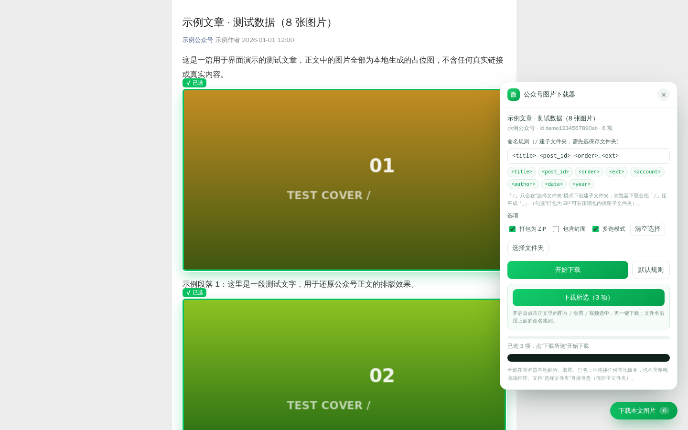

**合集页多选**：脚本也匹配 `https://mp.weixin.qq.com/mp/appmsgalbum*`，合集页右下角有 **“合集批量下载”** 悬浮按钮，点开的小窗口里可以：
- **选择保存位置**（File System Access，直接写入所选文件夹，保留子目录）；
- **填写重命名规则**（与单篇同一套变量，`/` 建子文件夹）；
- 点 **“进入多选模式”**（默认关闭），勾选多篇后 **“批量下载所选文章”**。

不装浏览器也能跑核心自测：

```bash
node --check userscript/wxmp.user.js
node userscript/test.js        # 使用 testdata/article-fixture.html 断言解析、/0 原图、去重、命名
```

### 1.6 油猴脚本（推送终端版）

`userscript/wxmp-push.user.js` 与独立版**分开保存**，适合 NAS / 常开 Docker 下载：

1. 先在 Docker 或 exe 上启动 WebUI（默认 `http://127.0.0.1:2178`）。
2. 安装脚本，打开公众号文章页，右下角 **“推送到终端”**。
3. 面板里填 **服务地址（终端 IP:端口）**、**服务端下载目录**、**重命名规则** → 保存 → **推送当前文章**。脚本把 `out_dir`、`name_template` 一起发给 `/api/download`，服务端按你填的目录/规则落盘。
4. 合集页右下角有 **“推送到终端”** 悬浮按钮（位置比独立版高，两个脚本同装也不重叠），点开的小窗口里有同样的地址/目录/规则设置，再进入多选模式 → 勾选文章 → **“批量推送所选”**。

**正文媒体多选推送**：文章页面板里也有 **“多选模式”**，点选正文中的图片 / 动图 / 视频（选中项显示蓝色高亮框和 **“✓ 已选”**），点 **“推送所选（N 项）”** 后脚本把 `pick.page_url` 与所选媒体地址发给 `/api/download/media`；服务端读取文章、按**与整篇下载相同的命名规则**渲染文件名并落盘，多选只下载被点中的项。该接口需要本版本的 Docker 镜像 / exe，旧版本会返回 404（脚本会提示更新）。

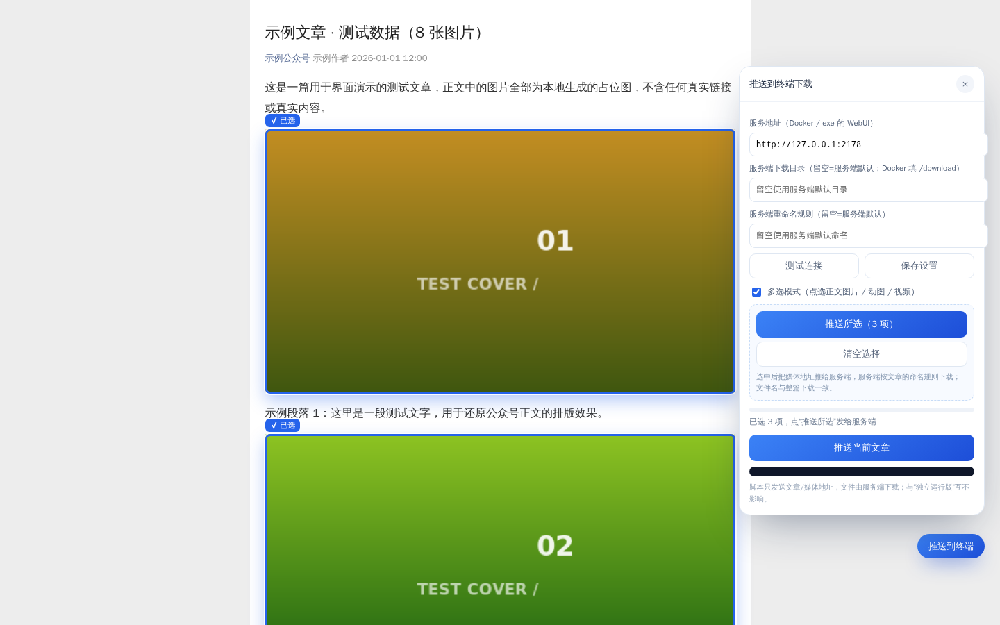

> **路径注意**：推送版填的是**服务端视角**的路径。Docker 里宿主目录 `./downloads` 挂载为容器内的 **`/download`**，所以这里要填 `/download`（或它下面的子目录），不能填宿主绝对路径；Windows exe 则直接填本机路径，如 `D:\公众号图片`。只填服务地址、不填目录时，服务端会用它的默认下载目录。

两个脚本互不依赖，可同时安装；推送版只发链接/媒体地址，独立版在浏览器本地保存。

---

## 2. 命名规则（重点）

默认规则：

```text
<文章标题>-<文章id>-<图片序号>.<扩展名>
```

等价英文写法：

```text
<title>-<post_id>-<order>.<ext>
```

渲染示例：`示例文章标题-demo1234567890ab-1.png`。

### 2.1 变量表

| 变量 | 中文别名 | 含义 | 示例 |
| --- | --- | --- | --- |
| `<title>` | `<文章标题>` | 文章标题 | 示例文章标题 |
| `<post_id>` | `<文章id>` | 文章短链 id（`/s/` 后面那串） | demo1234567890ab |
| `<order>` | `<图片序号>` | 图片序号，从 1 开始 | 3 |
| `<order2>` | `<序号2>` | 两位补零序号 | 03 |
| `<ext>` | `<扩展名>` | 扩展名，不含点 | png |
| `<account>` | `<公众号>` | 公众号名称 | 示例公众号 |
| `<author>` | `<作者>` | 作者 | 示例作者 |
| `<date>` | `<日期>` | 发布日期 | 2026-10-21 |
| `<time>` | `<时间>` | 发布时间 `HHMMSS` | 173000 |
| `<year>` | `<年>` | 发布年份 | 2026 |
| `<month>` | `<月>` | 发布月份 | 10 |
| `<day>` | `<日>` | 发布日 | 21 |
| `<kind>` | `<类型>` | `image` / `gif` / `video` | image |
| `<width>` | `<宽>` | 原图宽度 | 1254 |
| `<height>` | `<高>` | 原图高度 | 1254 |
| `<biz>` | — | 公众号 biz | MzkwMDAwMDAwMA== |
| `<sn>` | — | 文章 sn | 3c28e0d4... |
| `<mid>` | — | 文章 mid | 2247523869 |
| `<idx>` | — | 文章 idx | 1 |
| `<file_id>` | — | 微信图片 fileid | 100040218 |
| `<source>` | — | `content` / `picture` / `cover` | content |

不写 `<ext>` 时程序会自动补真实扩展名。

### 2.2 用 `/` 创建子文件夹

```text
<文章标题>/<文章id>-<图片序号>.<扩展名>
```

实际保存为：

```text
/download/示例文章标题/demo1234567890ab-1.png
/download/示例文章标题/demo1234567890ab-2.jpg
```

也可以多层：

```text
<公众号>/<日期>/<文章标题>/<order2>.<ext>
→ /download/示例公众号/2026-10-21/示例文章标题/01.png
```

规则说明：

- `/` 和 `\` 都视为目录分隔符；每一段单独做非法字符清洗。
- 文件名禁止的字符 `< > : " | ? *`、控制字符会被替换为 `_`；Windows 保留名（CON、NUL 等）自动加 `_`。
- 模板渲染后的相对路径不允许越出下载根目录（`..` 会被清洗并通过 `filepath.Rel` 双重校验）。
- 同名文件默认跳过；`-force` / “覆盖已有”才覆盖；同一批内重名会自动加 `-2`、`-3`。

### 2.3 合集命名规则（单独设置）

下载公众号文章合集时使用独立模板，默认：

```text
<collection_title>/<collection_order>-<title>/<post_id>-<order>.<ext>
```

中文写法：

```text
<合集标题>/<合集内文章序号>-<文章标题>/<文章id>-<图片序号>.<扩展名>
```

除单篇全部变量外，新增：

| 变量 | 中文别名 | 含义 | 示例 |
| --- | --- | --- | --- |
| `<collection_title>` | `<合集标题>` | 合集标题 | 示例合集 |
| `<collection_id>` | `<合集ID>` | 合集 id（链接里的 `album_id`） | 9876543210 |
| `<collection_order>` | `<合集内文章序号>` | 文章在合集内的序号（1 = 最早，越大越新） | 106 |

示例输出：

```text
/download/示例合集/106-示例文章标题/1000000001-1.png
/download/示例合集/106-示例文章标题/1000000001-5.gif
```

`/` 同样建子目录；合集模板在 WebUI、CLI（`-collection-name`）、APK 里都可单独修改。油猴脚本多选下载沿用**单篇**规则，不额外使用合集模板。

正文媒体多选（两个油猴脚本）使用与整篇下载**完全相同**的模板和变量取值：`<order>` 取该媒体在文章里的序号（不是“第几个选中”），所以同一张图无论整篇下载还是多选下载都会得到同一个文件名；服务端推送版还会用文章解析结果覆盖扩展名、宽高与 `<kind>`，保证与整篇下载一致。

---

## 3. 功能细节

- **只取原图**：正文 `data-src` 常以 `/640?wx_fmt=jpeg` 结尾，程序把最后一段尺寸替换成 `/0`，拿到公众号图床保存的原始尺寸（实测 1080×1080 → 1254×1254，1080×1525 → 2508×3541）。
- **GIF 动图**：识别 `data-type="gif"`、`wx_fmt=gif`、`.gif`，按 `gif` 类型保存，保留动画帧；GIF 的 `/0` 同样是原图。
- **图片消息**：除普通图文外，支持 `picture_page_info_list` 形式的图片消息；只取每个条目自己的顶层 `cdn_url`，不会误取 `watermark_info` 水印图。
- **顺序与去重**：以正文 `#js_content` 出现顺序为准，按 CDN host+path 去重；`picture_page_info_list` 中重复的图不会重复下载。
- **封面可选**：默认不下载封面；CLI `-cover`、WebUI 勾选“附带封面”、油猴勾选“附带封面”。
- **内嵌视频（实验性）**：`-video` / “尝试视频”会在页面里探测直接视频地址与 `mpvideo` 计数；微信视频多需专用接口，失败会给出提示而不影响图片。
- **健壮下载**：并发 1–16（默认 4）、每张 3 次重试、`.part` 临时文件原子改名、真实文件头校验、按真实尺寸/格式修正扩展名、MD5 记录、失败不影响其它图片。
- **跳过已存在**：按目标文件名判断，已存在且非空即跳过；`-force` 覆盖。
- **合集批量**：识别 `mp/appmsgalbum` 链接，解析 `window.cgiData` 首屏 + JSON 分页接口，**整册枚举**（不设篇数上限，翻到合集末尾或接口不再前进为止）；WebUI/APK 可先解析出文章列表，CLI 用 `-max-articles` 限制；每篇文章单独解析、下载，合集元数据回填后按合集模板命名。
- **环境异常**：触发微信“环境异常”验证页时，会提示先在浏览器打开一次文章（或提供 Cookie），不会把验证页当图片保存。

### 3.1 定时追更（1.3.0 新增）

**能追什么**（三种追更方式，添加时可选）：

| 方式 | 添加方式 | 扫描方式 | 需要 Cookie |
| --- | --- | --- | --- |
| **合集 / 文集** | 粘贴合集链接 | 官方 `appmsgalbum` JSON 分页，只翻到「已见过」的位置为止 | 否 |
| **公众号 · 公开合集** | 粘贴该号任意一篇文章链接 | 用文章页 `album_info` 发现该号的公开合集，逐个合集扫描 | 否 |
| **公众号 · 全部文章** | 粘贴该号任意一篇文章链接（或从搜索结果点「追更全部文章」） | `profile_ext?action=getmsg` 逐页拉取该号文章列表，**每发一篇就追一篇** | **是**（含 uin/key） |

> 微信对匿名访问只公开「合集」文章列表；「全部文章」必须带微信登录态（`uin` + `key`），这是微信的平台限制，不是本工具的选择。没有 Cookie 时任务会创建但扫描会明确报错提示，不会假装成功。

**微信 Cookie 怎么填**：WebUI「定时追更 → 微信 Cookie」里粘贴（**只存内存，不落盘、不写日志**，容器重启后需重填）；也可以启动容器时设环境变量 `WXMP_COOKIE="uin=...; key=...; wap_sid2=..."`（写在宿主的 shell/未入库的 env 里，别提交到仓库）。Cookie 需包含 `uin`、`key` 两项，界面会显示「已设置（含 uin/key）」。

**首次扫描**：默认只建立基线（把现有文章记为已见），之后只下载新发布的文章。想补下历史，在添加时填「首次补下最近 N 篇」。

**下载起点（含起点自身）**：每个追更任务可以指定「从哪一篇开始下载」——

- 点任务里的「选择起点」会列出该合集（公众号任务则是各合集）最近的文章，选一篇确认即可；
- 含义是**包含这一篇、向更新的方向**下载；更早的文章不会下；
- 设置后**整册枚举**并立即从起点补下（不设篇数上限，一次可覆盖整册；按 30 篇一个任务排队），起点之前的老文章会一并记为已见，之后回到「只追新文章」；
- 起点原文若已被作者删除，会按它的发布时间兜底补下，并在提示里注明「起点原文已不在合集里」；
- 「按起点补下」可重跑（已存在的文件会跳过），「清除起点」则恢复为只追新文章并重建基线。

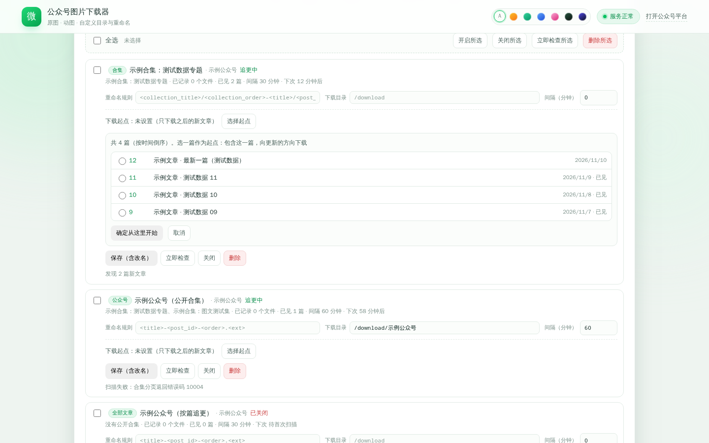

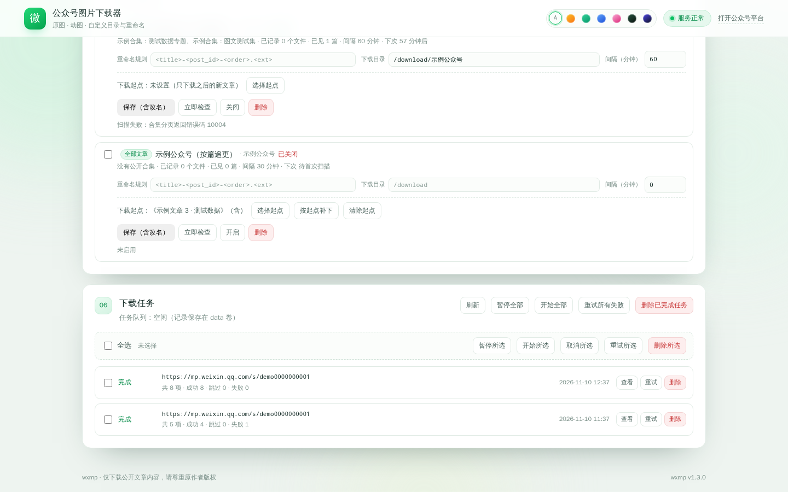

**独立设置**：每个追更任务都有独立的

- 重命名规则（`template`）：留空＝默认规则；合集默认为合集规则，公众号默认为单篇规则；
- 下载目录（`dir`）：留空＝默认目录；
- 扫描间隔（分钟，0＝跟随全局）。

**改规则会连带改名**：每个已下载文件都记录了当时的模板变量快照。修改追更任务的重命名规则后，程序立刻按新规则重命名这些老文件；**原文件已不存在（作品被删、被手动移走）的跳过并保持原样**，界面会提示「N 个文件已不存在，保持原样」。

**限制与礼貌**：

- 合集若是「倒序」（旧→新）排列，新文章在列表末尾：程序会按发布时间自动识别并多翻几页（最多 10 页），仍翻不到时在提示里注明「下轮继续」；
- 扫描是**串行**的，两次扫描之间至少间隔 `min_gap`（默认 60 秒），并在每轮加随机抖动；
- 单轮最多下载 `max_new` 个（默认 10），剩下的下一轮继续；
- 定时器只在任务启用且到点时才扫，不并发打同一个接口。

### 3.2 下载任务队列（1.3.0 新增）

- 任务进队列后串行执行，可随时 **暂停**（当前文件下载完就停，已下载的保留）、**继续**（重新排队，已存在的文件跳过，不会重复下载）、**取消**、**重试**。
- 支持「暂停全部 / 开始全部 / 重试所有失败 / 删除已完成任务」，也支持勾选若干任务后批量暂停、开始、取消、重试、删除。
- 删除任务只删记录，**不会删除已下载的文件**；「删除已完成任务」保留失败任务，方便再试。
- 通过链接下载时，解析出来的每篇文章/合集都可以在自己的卡片里**临时**改下载目录与重命名规则；不改就跟随全局设置。

---

### 3.3 界面主题（1.3.0）

WebUI 右上角可一键切换配色，**7 种选择**，记在浏览器本地（`localStorage`），刷新/重开都保持：

| 主题 | 说明 |
| --- | --- |
| `跟随系统` | 按操作系统的浅色/深色偏好自动选 薄荷 或 深色（系统切换时实时跟随） |
| `阳光模式` | 暖米色背景 + 琥珀/橙点缀，白天看着不刺眼 |
| `薄荷`（默认） | 浅绿背景 + 微信绿点缀 |
| `海盐` | 冷白蓝背景 + 蓝点缀 |
| `樱花` | 粉调背景 + 玫红点缀 |
| `深色模式` | 墨绿黑背景 + 翡翠绿点缀，夜间不刺眼 |
| `午夜蓝` | 深蓝黑背景 + 靛蓝点缀 |

实现上用 CSS 变量 + `<html data-theme>` 切换；`/static/theme.js` 在首屏渲染前套用主题，刷新不会闪白/闪黑；顶栏是半透明毛玻璃，卡片/输入框/日志面板/任务列表都跟随主题取色。

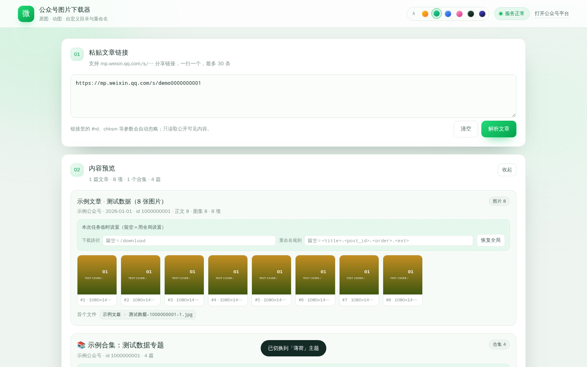

| 阳光模式 | 深色模式 |
| --- | --- |
| 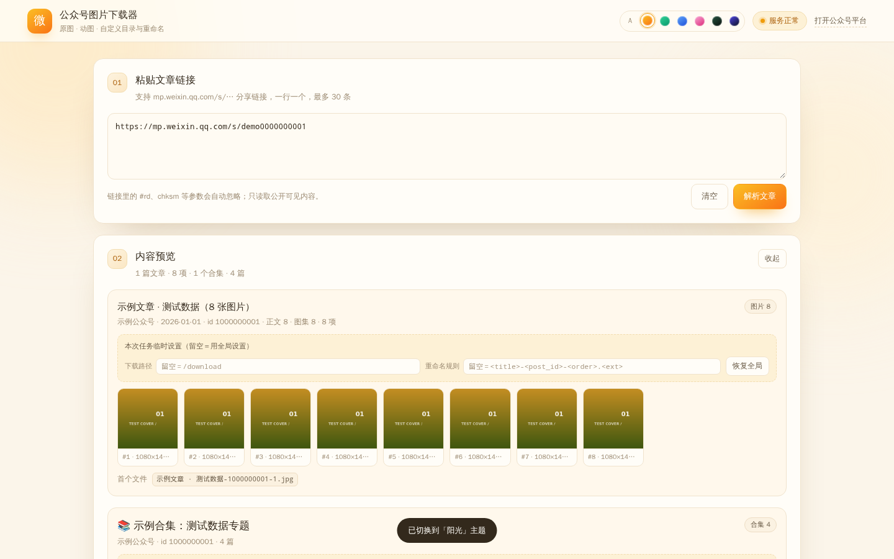 | 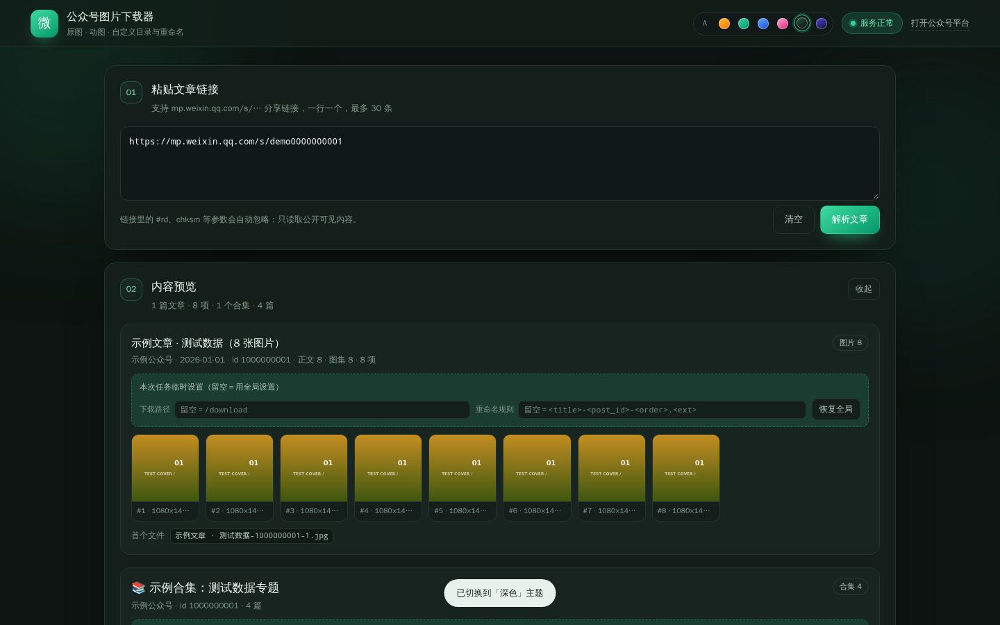 |

| 海盐 | 樱花 | 午夜蓝 |
| --- | --- | --- |
| 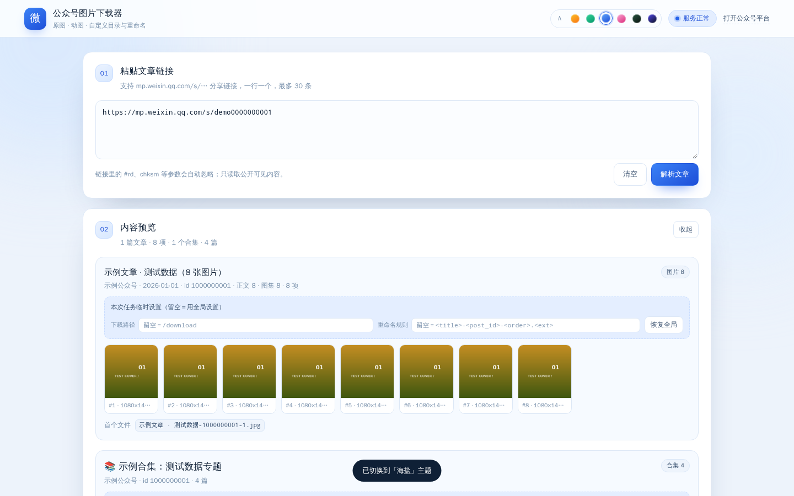 | 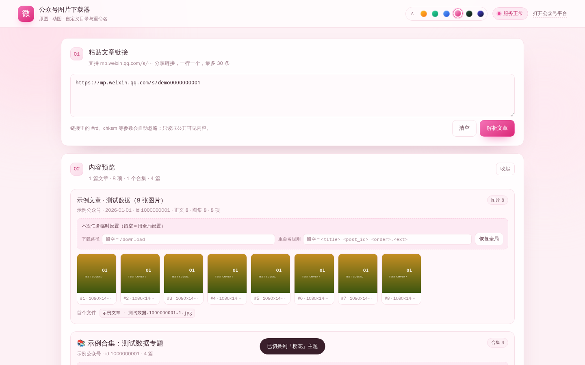 | 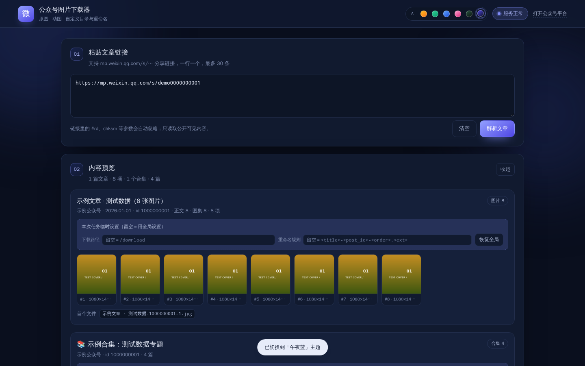 |

## 4. WebUI

启动后：

1. **01 粘贴文章链接**：每行一个，最多 30 条；支持带 `#rd`、`chksm` 等参数的分享链接。
2. **02 内容预览**：显示标题、公众号、发布时间、图片数量、缩略图、尺寸、GIF 标记、首个文件名。
3. **03 下载设置**：下载目录（含“打开目录”）、并发数、“附带封面 / 尝试视频 / 覆盖已有”、命名规则输入 + 变量快捷插入 + 实时预览 + 恢复默认。
4. **04 下载进度**：进度条、成功/跳过/失败统计、实时日志、文件列表、暂停/继续/取消按钮。
5. **05 定时追更**：全局开关与扫描间隔；按合集链接或文章链接添加追更；按名称/微信号/`__biz` 搜索本机记录过的公众号；每个追更任务可改重命名规则、下载目录、间隔，并显示「已见 N 篇 / 已记录 M 个文件 / 上次扫描结果」。
6. **06 下载任务**：任务列表（状态、来源、计数、时间）+ 多选批量操作 + 暂停全部/开始全部/重试所有失败/删除已完成。

设置自动保存在浏览器 `localStorage`（键 `wxmp.settings.v1`），主题单独存在 `wxmp.theme.v1`。也支持 `?url=<文章链接>` 直接解析，方便做书签。

### HTTP API（自测/集成用）

| 方法 | 路径 | 说明 |
| --- | --- | --- |
| GET | `/api/config` | 默认目录、命名规则、变量表、并发上限 |
| GET | `/api/health` | 健康检查 |
| POST | `/api/parse` | `{"urls":[...],"name_template":"..."}` 解析文章 |
| POST | `/api/preview` | 按模板渲染文件名（不下载） |
| POST | `/api/download` | 创建下载任务；`tasks:[{url,out_dir,name_template,collection_template}]` 可给每个任务单独的目录与规则 |
| POST | `/api/download/media` | 推送正文多选媒体：`{"pick":{"page_url":"...","picked":[{url,ext,kind,width,height,is_gif}]},"out_dir":"...","name_template":"..."}`；服务端重新解析文章并按同一套命名规则下载所选媒体 |
| GET | `/api/jobs` | 任务列表 + 队列状态 |
| GET | `/api/jobs/{id}` | 任务进度与结果 |
| POST | `/api/jobs/{id}/cancel` | 取消任务 |
| POST | `/api/jobs/{id}/pause` | 暂停任务 |
| POST | `/api/jobs/{id}/resume` | 继续任务（已下载文件跳过） |
| POST | `/api/jobs/{id}/retry` | 重试任务 |
| DELETE | `/api/jobs/{id}` | 删除任务记录（不删文件） |
| POST | `/api/jobs/pause-all` | 暂停全部 |
| POST | `/api/jobs/resume-all` | 开始全部 |
| POST | `/api/jobs/retry-failed` | 重试所有失败任务 |
| POST | `/api/jobs/clear-completed` | 删除已完成任务 |
| POST | `/api/jobs/batch` | `{"action":"pause\|resume\|cancel\|retry\|delete","ids":[...]}` |
| GET | `/api/subs` | 追更任务 + 全局配置 |
| POST | `/api/subs` | 新增/修改追更任务（改规则会立即重命名已下载文件） |
| DELETE | `/api/subs/{id}` | 删除追更任务 |
| POST | `/api/subs/{id}/check` | 立即扫描一次 |
| GET | `/api/subs/{id}/articles?pages=5` | 列出最近文章（选择下载起点用） |
| POST | `/api/subs/{id}/backfill` | 按已设置的起点重新补下 |
| POST | `/api/subs/batch` | `{"action":"enable\|disable\|delete\|check","ids":[...]}` |
| POST | `/api/subs/config` | 追更全局配置 |
| POST | `/api/subs/search` | `{"q":"名称/微信号/__biz/链接"}` 搜索本机公众号或解析链接 |
| POST | `/api/settings/cookie` | `{"cookie":"uin=..; key=.."}` 设置微信 Cookie（仅内存） |
| GET | `/api/thumb?u=...&s=300` | 缩略图代理（仅微信图床域名） |
| POST | `/api/open-dir` | 打开下载目录（本机运行时） |

---

## 5. 构建

### 5.1 Go 二进制

```bash
go build -trimpath -o wxmp ./cmd/wxmp

# Linux 静态（容器用）
CGO_ENABLED=0 GOOS=linux GOARCH=amd64 go build -trimpath -ldflags "-s -w" -o build/wxmp-linux-amd64 ./cmd/wxmp

# Windows
CGO_ENABLED=0 GOOS=windows GOARCH=amd64 go build -trimpath -ldflags "-s -w" -o dist/wxmp-windows-amd64.exe ./cmd/wxmp
```

`scripts/build.sh` 会一次性完成 gofmt 检查、`go vet`、单测、Linux/Windows 交叉编译并注入版本号。

### 5.2 Docker 镜像

```bash
# 快速构建（复制 build/wxmp-linux-amd64）
docker compose build

# 完全源码构建（容器内编译）
docker build -f Dockerfile.source -t wechat-mp-downloader:source .
```

### 5.3 Android APK

无需 Gradle，使用 Android SDK 命令行工具：

```bash
export ANDROID_SDK_ROOT=/opt/android-sdk
export JAVA_HOME=/opt/jdk21
bash android/build-apk.sh
# 产物：dist/wxmp-android.apk
```

脚本流程：`aapt2 compile → aapt2 link → javac --release 8 → d8 → zip 注入 classes.dex → zipalign → apksigner`。首次会自动生成 `android/wxmp-release.keystore`（alias `wxmp`，口令 `wxmp123456`，仅用于本地测试签名）。

> 注意：本仓库的 Android 代码不使用匿名内部类与 lambda，全部用具名 static 嵌套类 + `Handler`；这是为了绕开 build-tools 34.0.0 的 d8 在解析 javac 21 匿名类时的 NPE。

---

## 6. 目录结构

```text
wechat-mp-downloader/
├── cmd/wxmp/              # CLI 入口、批量处理、Windows 控制台
├── internal/wx/           # 抓取、解析、命名、下载（纯标准库）
├── internal/webui/        # WebUI 服务、任务队列、定时追更（subs.go）、静态页面
├── android/               # 原生 Android 工程（无 Gradle）
├── userscript/            # wxmp.user.js（独立版）+ wxmp-push.user.js（推送版）+ test.js
├── docker-compose.yml
├── Dockerfile             # 预编译二进制快速镜像
├── Dockerfile.source      # 源码构建镜像
├── scripts/build.sh
├── deploy.sh
├── docs/                  # 界面截图（测试数据）
├── testdata/
├── LICENSE                # MIT
└── README.md
```

> `build/`、`dist/` 是本地构建产物（二进制、APK、压缩包），已在 `.gitignore` 中忽略，不随源码包分发。

---

## 7. 常见问题

**Q：提示“环境异常/访问过于频繁”？**
微信对匿名请求有风控。先用浏览器打开该文章一次，再把浏览器 Cookie 传给 CLI：`wxmp -cookie "..." 链接`，或设置环境变量 `WXMP_COOKIE`。WebUI 的 Cookie 支持在服务端配置（不落盘）。

**Q：合集链接怎么用？**
直接粘贴 `https://mp.weixin.qq.com/mp/appmsgalbum?...&album_id=...`。WebUI/APK 会显示合集文章列表；CLI 加 `-max-articles 2` 只下前 2 篇。合集命名规则在 WebUI「合集重命名规则」、CLI `-collection-name`、APK 合集规则输入框里单独设置。

**Q：命名规则里写了 `/bilidown/...`，为什么文件名变成 `bilidown_...`、也没建子文件夹？**
浏览器原生下载只能落到下载目录的一个文件，网页/油猴脚本无法在磁盘上随意建目录，所以脚本会把 `/` 替换成 `_`。想保留 `/` 的层级：先在面板点 **“选择文件夹”**（Chrome / Edge 支持，文件会写入该文件夹并自动创建子目录），或勾选 **“打包为 ZIP”**（压缩包内保留子文件夹），或改用推送版由服务端创建目录。规则里的前导 `/` 不是磁盘根路径，而是相对于所选文件夹 / 服务端下载目录。

**Q：221 篇的合集只解析到 220 篇 / 提示“合集分页解析失败：cannot unmarshal object into … article_list”？**
这是微信接口在**最后一页只剩 1 篇**时把 `article_list` 序列化成对象而不是数组导致的，不是篇数上限；已修复（旧镜像/exe 需要更新）。修复后程序会继续翻到合集末尾，例如 221 篇的合集实测解析到 221 篇（含最老的 `pos_num=1`）。

**Q：两个油猴脚本装哪个？**
想完全在浏览器本地保存（可打包 ZIP、可选文件夹）装 `wxmp.user.js`；想把手上的链接交给常开的 Docker/exe 去下载装 `wxmp-push.user.js`。二者互不依赖，可同时装。

**Q：下载下来的是缩略图？**
本工具默认把 `/640` 等尺寸段替换为 `/0`。如果某张图在 CDN 上没有原图，`/0` 会返回与页面相同尺寸，这是微信侧的限制。

**Q：动图变成静态图？**
确认保存的扩展名是 `.gif`（预览里有 GIF 徽标）。若文章把动图以视频形式插入，请用 `-video` 尝试视频下载。

**Q：端口 2178 被占用？**
改 `.env` 的 `WEB_PORT`，例如 `WEB_PORT=2180`，然后 `docker compose up -d`。

**Q：容器里“打开目录”没反应？**
容器内无法打开宿主文件管理器，属正常现象；直接去宿主挂载目录查看。本机运行 exe/二进制时该按钮可用。

**Q：按篇追更提示「微信只对登录态开放公众号文章列表」？**
说明还没填微信 Cookie，或 Cookie 里缺 `uin`/`key`。在「定时追更 → 微信 Cookie」粘贴含这两项的 Cookie（仅内存），或启动时给 `WXMP_COOKIE`。没有登录态时请改用「合集」或「公众号 · 公开合集」。

**Q：为什么「搜索公众号作者」搜不到某个号？**
微信没有对外的公众号搜索接口（搜狗微信搜索对匿名请求也不返回结果），所以搜索范围是**本机解析过的公众号**（每解析一篇文章就会记下来）。要追更某个号：直接粘贴它任意一篇文章链接解析并添加；如果它没有公开合集，微信侧无法列举新文章，程序会明确告知。

**Q：追更的公众号新文章没下到？**
公众号追更只能覆盖「公开合集」里的文章。若作者把新文章放在别的新合集里，在追更任务的 `albums` 里补上那个合集链接（或直接再添加一个合集追更）。

**Q：改了追更的重命名规则，老文件没改名？**
文件已不存在（被删/被移走）时按需求保持原样，界面会显示「N 个文件已不存在，保持原样」；只记录**通过追更下载**的文件，手动用链接下载的文件不在追更改名范围内。

**Q：Android 下载到哪？**
默认 App 专属目录，不需要存储权限；可点“选择目录”授权任意文件夹（SAF）。

---

## 8. 验证记录（摘要）

完整的开发期验证记录保留在内部开发仓库中，不随发布包分发。

- 因为公众号文章会失效/被删，仓库里的回归验证使用**离线 fixture + 合成样本**；README 中的截图也全部由内置测试数据生成，不含任何真实账号内容。
- CLI：对合成样本 8/8 成功，`/0` 原图尺寸与声明一致（`1254×1254`、`2508×3541` 等）。
- 中文子目录模板：生成 `示例文章标题/<示例id>-1.png` … `-8.jpg`；重复运行全部跳过。
- WebUI：`/api/parse` 2.83s 返回 8 项；`/api/download` 任务 `done`，8 成功 0 失败；缩略图代理返回 PNG。
- Windows exe（Wine 实测）：8/8 成功，中文子目录正确。
- Android APK：`apksigner verify` 通过；在 x86_64 模拟器里实际输入测试链接，解析出 8 项并下载，日志显示「8 成功 · 0 跳过 · 0 失败」；同源代码的桌面 JVM 自测 8/8、3,268,131 字节。
- 油猴脚本：`node --check` 通过；`node userscript/test.js` 断言解析、GIF 识别、去重、`/0` 原图与中文命名全部通过。
- Docker：`docker-compose config` 校验出 `network_mode: bridge`、`2178:2178`、宿主目录挂载；同一镜像运行层（Alpine 3.20 + musl 静态二进制 + entrypoint）在 chroot 内完成 8/8 下载与 WebUI 健康检查。实际 `docker build/up` 需在具备容器权限的宿主机执行。

### 1.1.0 修复（短链 id 与重复计数）

- `<post_id>` / `<文章id>` 改为取文章链接 `/s/` 后的短 id（如 `demo1234567890ab`）；缺失时才回退 `appmsgid`/`mid`。数字 id 仍可用 `<mid>`。
- 修复“3 张图显示成 6 张”：同一张图在正文里可能是 `mmbiz_jpg/<hash>`、在图集里是 `sz_mmbiz_jpg/<hash>`，旧去重键包含目录前缀导致重复；现按图片 hash（最后一段非尺寸段）去重。
- 用同一篇合成样本实测：CLI、WebUI、Android core（桌面 JVM）与油猴解析均为 **3 张**，下载 3/3 成功。

### 1.1.4 加固（仍报 6 张时）

- 去重身份使用 **完整文件名**；1.1.4 曾短暂改成 hash 前 16 位，1.2.1 已修正——微信 CDN 的不同图片也可能共享前 33 个字符，截前缀会把 4 张图误合并成 1 张。
- 图集与正文“数量相同、尺寸逐项相同”时，整组视为镜像并忽略，即使两边的 hash 完全不同也能折叠。
- 下载器额外按 **文件 MD5** 去重：不同 URL 返回相同字节时，只保留第一份，其余标记为“跳过重复文件”。
- WebUI 文章卡新增 `正文 X · 图集 Y` 和黄色警告条，能直接看出 6 张来自正文、图集还是重复链接。

### 未发布 · 正文媒体多选（2026-11-06）

- 两个油猴脚本（独立版 `1.4.1`、推送版 `1.2.0`）在文章页面板新增 **“多选模式”**：直接点选正文里的图片 / 动图 / 视频，选中项显示高亮框 + **“✓ 已选”**，再点取消；面板里有一键 **“下载所选（N 项）”** / **“推送所选（N 项）”** 与 **“清空选择”**。
- 独立版复用了整篇下载的解析、命名与保存链路：命中正文解析的媒体沿用原 `<order>` / 扩展名 / 宽高，解析外的视频接在正文序号之后；保存到“选择文件夹”指定的位置或浏览器下载目录，ZIP、重名跳过等行为与整篇下载一致。
- 推送版新增服务端接口 `POST /api/download/media`：脚本只发文章地址与所选媒体地址，服务端重新解析文章、按同一套命名规则渲染文件名后下载，选中的媒体之外不会多下；旧版本服务端返回 404 时脚本会提示更新镜像 / exe。
- 新增 Go 测试：多选请求校验（空选、合集页、非法主机、非法扩展名、非法模板）、多选命名与整篇一致（含 JS/Go 查询串顺序不同的同一张图）、解析外视频序号兜底、`/api/download/media` 路由；`node userscript/test.js` 新增 `pickedMediaObjects` 命名断言。Chromium CDP harness 实测两个脚本的选中框、计数、取消选择与下载/推送载荷。
- 修复合集分页：微信在**最后一页只剩 1 篇**时把 `article_list` 返回成对象而非数组，旧代码因此报「合集分页解析失败」并丢掉最老一篇（221 篇合集只显示 220 篇）。现在兼容两种形态；实测该合集解析 221/221、无缺口、无警告。
- 独立版补充子文件夹提示：命名规则含 `/` 且未选择保存文件夹时，浏览器下载无法建目录，脚本会在日志明确提示「/ 被替换成 _」（面板也加了说明），并引导使用“选择文件夹”/ ZIP / 推送版。

### 1.3.0 定时追更 + 任务队列

- 新增定时追更：合集 / 公众号两类追更任务，每个任务独立重命名规则与下载目录；定时串行扫描，发现新文章自动建下载任务。
- 追更支持**下载起点（含起点自身）**：在任务里选一篇，从它开始向更新的方向补下；起点原文消失时按发布时间兜底。
- 新增**按篇追更**（公众号 · 全部文章）：用 `profile_ext?action=getmsg` 逐篇拉取该公众号文章列表，需要含 `uin/key` 的微信 Cookie（仅内存 / `WXMP_COOKIE`）。
- 新增**界面主题**：7 种配色（跟随系统 / 阳光 / 薄荷 / 海盐 / 樱花 / 深色 / 午夜蓝），CSS 变量驱动，主题在首屏前套用，深浅色两套完整适配。
- 修复合集分页方向：微信合集接口默认按合集自身顺序返回（有的合集是旧→新），追更改为用 `is_reverse=1` 取最新一页，`<collection_order>` 按合集位置（最旧=1）填充。
- 改追更的重命名规则时，已下载文件按新规则自动改名；原文件不存在的跳过（保持原样）。
- 新增下载任务队列：暂停 / 继续 / 取消 / 重试、暂停全部 / 开始全部 / 重试所有失败 / 删除已完成、多选批量操作。
- 链接下载支持「每篇文章临时改下载目录与重命名规则」，不改则跟随全局。
- 版本号统一：WebUI/CLI `1.3.0`、Android `1.3.0 (versionCode 4)`、独立版油猴 `1.3.0`、推送版油猴 `1.1.0`。
- 本地用合成样本回归：合集建立基线 → 按起点补下 → 改规则后已下载文件按新规则改名；删掉 1 个文件再改规则，结果为「N 个改名 + 1 个已不存在保持原样」；任务独立目录/规则落盘；暂停全部 → 提交 → 继续全部 → 自动开跑。

### 1.2.1 刷新续显与四图误合并修复

- **WebUI 刷新续显**：当前任务 ID 存入 `localStorage`，刷新页面后自动恢复进度卡、实时日志、文件列表与轮询；服务重启/任务清理后自动丢弃过期指针。
- **修复图片缺漏**：`cdnKey` 改为完整文件名去重，不再截取 16 位前缀；实测 `mid=2247488472` 文章正文 3 张 PNG + 1 张 GIF 全部保留（此前只剩 1 张）。
- Go / Android / 独立版油猴 / 推送版同步该去重规则；新增“共享 33 字符前缀的不同图片”回归测试。

### 1.2.0 合集批量与双版本油猴

- 新增公众号合集识别与批量下载：CLI `-max-articles` / `-collection-name`，WebUI 合集卡片，APK 合集输入，两个油猴脚本的合集多选。
- 合集批量：用合成合集（106 篇）验证解析与批量下载；CLI 下载前 2 篇 10 张（含 1 个 GIF）全部成功；WebUI 任务 `done total=5 success=5`；Android 模拟器里解析出 106 篇并开始批量下载，路径形如 `示例合集/106-示例文章标题/<id>-1.png`。
- 独立版油猴合集多选在浏览器 harness 实测：勾选 2 篇 → `完成：2/2 篇，2 张成功`，文件名 `测试文章标题-fixture1-1.png`、`测试文章标题-fixture2-1.png`，全程不连接本地服务。
- 推送版油猴在 mock 服务下实测：文章页推送提交 `{urls:[当前文章]}`；合集页勾选 2 篇提交两个链接，轮询任务状态到 `done`。

## 8.1 上机检查清单（开发环境无法验证的项）

以下项目需要具备对应工具链/真机的环境才能确认，**未在本仓库的开发环境中执行**：

- [ ] `docker compose config --quiet` 与 `docker compose up -d --build`：开发环境没有 Docker，仅静态检查了 compose 语法与挂载配置。
- [ ] 第二个下载目录 `FANBOOK_DIR` → 容器 `/fanbook`：需在宿主机确认目标目录存在、容器内 `/fanbook` 可写；本环境无 Docker，未实际起容器验证。
- [ ] Android APK 重建（`bash android/build-apk.sh` + `apksigner verify`）：开发环境没有 Android SDK/JDK，1.3.0 只改了 `AndroidManifest.xml` 的版本号与 `build-apk.sh` 的 `--version-code/--version-name`；**`dist/wxmp-android.apk` 仍是 1.2.1 的旧产物**，重新打包后才会显示 1.3.0。
- [ ] Windows `.exe` 在 Wine 下的实际运行（本次没有 Windows 环境）。
- [ ] 公众号作者追更在真实账号上的长期表现（依赖微信是否公开该账号的合集）。
- [ ] 「公众号 · 全部文章」按篇追更需要真实微信登录 Cookie（`uin`+`key`），开发环境无法获取，故未做真实拉取验证；解析器、错误分支、任务状态已用单测与假 Cookie 验证。
- [ ] 正文多选在**真实公众号文章**里的表现：开发环境只用合成文章页（CDP harness）验证了选中框、计数、命名与推送载荷；真实页面的懒加载图片、视频组件（`mp-common-videosnap` / `mpvideo`）能否取到 `.mp4` 地址、以及微信自带图片预览是否被多选模式拦截，需要上机确认。拿不到直接地址的视频会被忽略（不会生成坏文件）。

## 9. 声明

仅用于下载**公开可访问**的公众号文章图片，请遵守微信平台规则与著作权法，不要用于批量抓取、二次分发或商业用途。Cookie 只在内存中使用，不会写入磁盘或日志。

## 任务记录持久化（1.2.2+）

- 任务历史写在 `data/jobs.json`；Docker 已把 `./data` 挂到 `/data`，并用 `-data /data` 启动。
- 重启后已完成/失败/取消任务全部保留；重启时仍在运行的任务标为失败（“服务重启导致任务中断”）。
- WebUI 的「下载任务」面板可回看、点开旧任务结果，并对任务做暂停/继续/取消/重试/删除与批量操作。
- 追更任务写在 `data/subs.json`，本机公众号库写在 `data/accounts.json`；重启后继续按间隔扫描。
